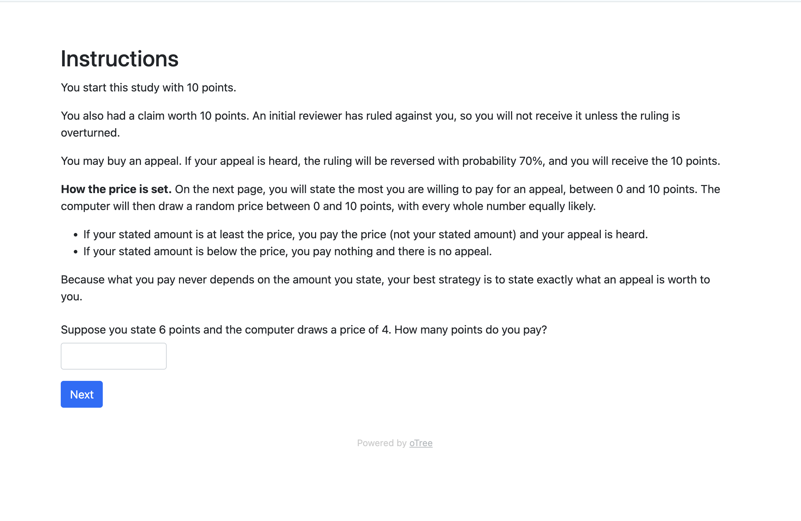
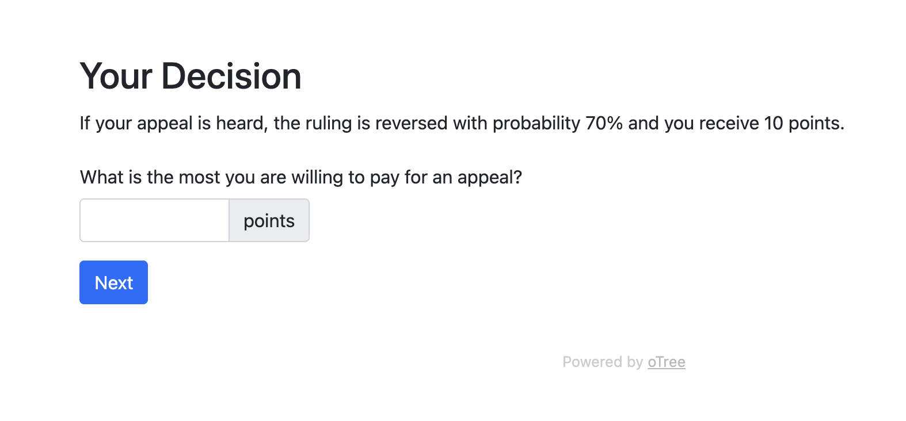
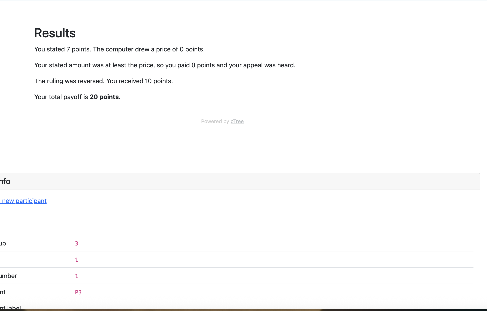

# Appeal WTP (oTree)

A single-player oTree experiment that elicits willingness to pay for an appeal using the BDM mechanism. Participants start with 10 points after losing a 10-point claim at an initial review, then state the most they would pay for an appeal. The computer draws a random price from 0 to 10, and the appeal is bought at that price if the bid is at least as high. A heard appeal reverses the ruling with probability 30% or 70%, randomly assigned, so risk-neutral bids are 3 and 7 points and deviations measure value placed on the procedure itself. A comprehension check confirms participants understand they pay the drawn price, not their bid.

To run: `pip install otree`, then `otree devserver`.

